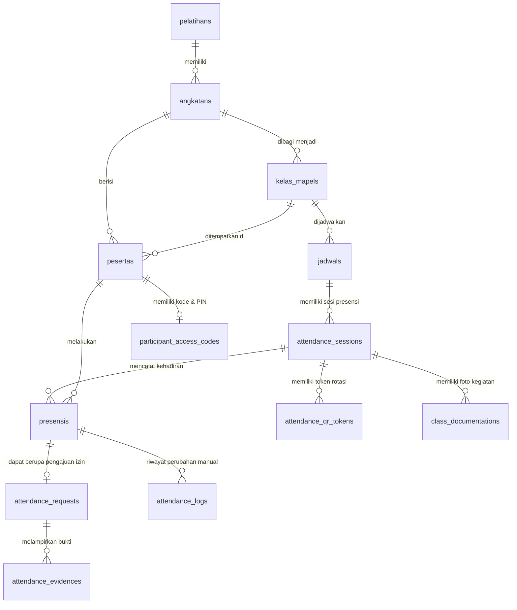

# LAPORAN AUDIT SOURCE CODE & RANCANGAN ARSITEKTUR
## PENGEMBANGAN MODUL PRESENSI PESERTA DIKLAT (HYBRID) KCLC PPSDMK
**Tanggal Audit:** 23 November 2026  
**Status:** Tahap 1 Selesai — Audit Source Code & Skema Database

---

## 1. STRUKTUR PROJECT & DEPENDENSI

### 1.1. Framework & Environment
- **Framework:** Laravel 12.0 (PHP 8.2+)
- **Database:** MySQL 8.0 / MariaDB (Database aktif: `sir_jp`)
- **Frontend Stack:** Laravel Blade Templates + Bootstrap 5.3 + Bootstrap Icons + Custom CSS (`public/assets/css/custom.css`) + SweetAlert2 (`public/assets/js/sweetalert2.all.min.js`) + Chart.js (`public/assets/js/chart.umd.min.js`).
- **Autentikasi Eksisting:** Laravel Session Auth untuk Penyelenggara/Admin Diklat (`users` table, role `penyelenggara`, login via NIK / Email / Username).

### 1.2. Library yang Digunakan
- `maatwebsite/excel: ^3.1`: Pembuatan ekspor spreadsheet Excel.
- `barryvdh/laravel-dompdf: ^3.1`: Pembuatan ekspor dokumen PDF.
- `chart.js`: Visualisasi grafik tren kehadiran dan statistik.
- `sweetalert2`: Konfirmasi aksi (bulk update, approval, pembatalan).

---

## 2. AUDIT TABEL DATABASE & RELASI EKSISTING

Berdasarkan pemeriksaan skema database `sir_jp` dan file migrasi:

### 2.1. Tabel Master yang Sudah Tersedia (JANGAN DIDUPLIKASI)
1. **`pelatihans`**: Master Program Pelatihan Diklat (`id`, `kode_pelatihan`, `nama_pelatihan`, `kategori`, `penyelenggara`, `tanggal_mulai`, `tanggal_selesai`, `status`).
2. **`angkatans`**: Angkatan Diklat (`id`, `pelatihan_id`, `nomor_angkatan`, `tanggal_mulai`, `tanggal_selesai`, `jumlah_peserta`, `status`).
3. **`kelas_mapels`**: Kelas Mata Pelatihan (`id`, `pelatihan_id`, `angkatan_id`, `mata_pelatihan_id`, `ruangan_id`, `nama_kelas`, `kapasitas`, `kurikulum`, `hari`, `jam_mulai`, `jam_selesai`, `metode_pembelajaran`).
4. **`kelas_mapel_pengajars`**: Pengajar per kelas (`id`, `kelas_mapel_id`, `pengajar_type`, `pengajar_id`, `jp`, `peran`).
5. **`ruangans`**: Master Ruangan Diklat (`id`, `nama_ruangan`, `kapasitas`, `lokasi`, `is_aktif`).
6. **`mata_pelatihans`**: Kurikulum materi pelatihan (`id`, `angkatan_id`, `nama_mata_pelatihan`, `rencana_jp`).
7. **`penugasan_pengajars`**: Penugasan Widyaiswara / Narasumber di SIR-JP (`id`, `mata_pelatihan_id`, `jenis_pengajar`, `widyaiswara_id`, `narasumber_id`).
8. **`jadwals`**: Jadwal Sesi Pembelajaran (`id`, `mata_pelatihan_id`, `penugasan_pengajar_id`, `tanggal`, `jam_mulai`, `jam_selesai`, `sesi_ke`, `jp_rencana`, `ruangan`, `metode`, `status`).
9. **`pesertas`**: Data Peserta Diklat (`id`, `angkatan_id`, `kelas_mapel_id`, `nip`, `nama`, `email`, `jenis_kelamin`, `instansi`, `jabatan`, `golongan`).
10. **`realisasi_jadwals` & `realisasi_pengajars`**: Realisasi pembelajaran pendukung perhitungan JP SIR-JP.
11. **`presensis`**: Tabel presensi awal hasil migrasi KCLC (`id`, `peserta_id`, `jadwal_id`, `kelas_mapel_id`, `tanggal`, `status_kehadiran`, `waktu_presensi`).

### 2.2. Relasi Antartabel Terkait Presensi

---

## 3. ANALISIS FITUR PRESENSI: EKSISTING VS KEBUTUHAN BARU

| Komponen | Kondisi Eksisting | Kebutuhan Pengembangan Modul Presensi |
|---|---|---|
| **Frekuensi Presensi** | Hanya tanggal harian di tabel `presensis` | **Per Sesi Mata Pelatihan** (Setiap jam pelajaran/sesi memiliki sesi presensi sendiri) |
| **Akses Peserta** | Belum ada portal peserta (hanya login admin) | **Portal Mandiri Peserta** (`/presensi/login`, `/presensi`) berbasis Kode Peserta + PIN hashed |
| **Metode Input** | Input database langsung / seeder | **Hybrid:** Scan QR Code dinamis + Input Manual Admin / Operator |
| **Keamanan QR Code** | Belum ada | Token acak di-hash dengan masa berlaku rotasi (30-60 detik), menolak sesi tutup/expired |
| **Status Kehadiran** | 4 status dasar (`Hadir`, `Izin`, `Sakit`, `Alpa`) | **6 status lengkap:** `Hadir` (Hijau), `Terlambat` (Biru), `Izin` (Kuning), `Sakit` (Pink), `Alpa` (Merah), `Dispensasi` (Ungu/Abu) |
| **Pengajuan Izin** | Belum tersedia | Alur pengajuan mandiri oleh peserta dengan upload file bukti, verifikasi persetujuan/penolakan admin |
| **Upload Dokumen & Foto** | Belum tersedia | 1. Bukti izin/sakit/dispensasi (PDF/Gambar) 2. Foto dokumentasi kegiatan per sesi/kelas |
| **Audit Trail Presensi** | Log umum di `log_aktivitas` | Tabel `attendance_logs` khusus mencatat nilai *sebelum*, *sesudah*, alasan perubahan, & admin pengubah |
| **Dashboard & Rekap** | Stat card global di dashboard utama | **Dashboard Khusus Presensi** + filter lengkap + Rekap per sesi, kelas, angkatan, & program |
| **Laporan & Ekspor** | Ekspor SIR-JP (Honor & Berita Acara) | **Laporan Presensi KCLC** (Excel multi-format, PDF cetak resmi, tampilan web print) |
| **Integrasi SIR-JP** | Menggunakan `realisasi_jadwals` | Presensi menjadi **data pendukung validitas realisasi pembelajaran** tanpa merusak formula JP |

---

## 4. POTENSI KONFLIK DATABASE & STRATEGI MITIGASI

1. **Tabel `presensis` yang Sudah Ada:**
   - *Analisis:* Tabel `presensis` telah digunakan dalam `EndToEndInterconnectedFlowTest` dengan kolom (`peserta_id`, `jadwal_id`, `kelas_mapel_id`, `tanggal`, `status_kehadiran`, `waktu_presensi`).
   - *Mitigasi:* **JANGAN DROP TABEL `presensis`**. Kita kembangkan tabel `presensis` menjadi tabel sentral kehadiran (`attendances`) dengan menambahkan kolom baru yang *nullable*:
     - `attendance_session_id` (foreignId to `attendance_sessions`, nullable)
     - `status_kehadiran` diperluas: `Hadir`, `Terlambat`, `Izin`, `Sakit`, `Alpa`, `Dispensasi`
     - `metode_presensi` enum: `QR`, `Manual`, `Sistem`
     - `waktu_check_in` (datetime)
     - `keterangan` (text)
     - `diinput_oleh` (foreignId to `users`, nullable)
     - `unique constraint`: `attendance_session_id + peserta_id`
   - *Hasil:* Pengujian lama (33 tests) tetap lulus 100%, sementara modul baru memiliki fungsionalitas penuh.

2. **Perhitungan JP pada SIR-JP:**
   - *Analisis:* SIR-JP menghitung JP berdasarkan `realisasi_jadwals` dan `realisasi_pengajars`.
   - *Mitigasi:* Sistem presensi bertindak sebagai **verifikasi kehadiran peserta** untuk mendukung status realisasi jadwal (misal: menampilkan persentase kehadiran peserta di layar realisasi), dan sama sekali **TIDAK mengubah rumus JP otomatis** pengajar di `JPRecapitulationService`.

---

## 5. RENCANA SKEMA DATABASE BARU (MIGRATIONS)

Tabel-tabel baru yang akan ditambahkan:
1. **`attendance_sessions`**:
   - `id`, `jadwal_id` (FK to jadwals), `kelas_mapel_id` (FK to kelas_mapels), `judul_sesi`, `tanggal`, `jam_mulai`, `jam_selesai`, `waktu_buka_presensi`, `waktu_tutup_presensi`, `toleransi_terlambat_menit`, `status` (Draft, Aktif, Selesai, Dibatalkan), `qr_secret_key`, `created_by` (FK to users).
2. **`attendance_qr_tokens`**:
   - `id`, `attendance_session_id` (FK), `token_hash` (varchar), `expired_at` (datetime), `is_active` (boolean).
3. **`participant_access_codes`**:
   - `id`, `peserta_id` (FK unique), `kode_peserta` (varchar unique, misal: `PST-2026-XXXX`), `pin_hash` (varchar hashed), `is_active` (boolean), `last_login_at` (datetime).
4. **`attendance_requests`**:
   - `id`, `peserta_id` (FK), `attendance_session_id` (FK), `jenis_pengajuan` (Izin, Sakit, Dispensasi), `alasan`, `status` (Pending, Approved, Rejected), `catatan_admin`, `diverifikasi_oleh` (FK to users), `diverifikasi_pada` (datetime).
5. **`attendance_evidences`**:
   - `id`, `attendance_request_id` (FK), `nama_file_asli`, `path_file`, `mime_type`, `file_size`, `keterangan`.
6. **`class_documentations`**:
   - `id`, `attendance_session_id` (FK), `kelas_mapel_id` (FK), `nama_file_asli`, `path_file`, `mime_type`, `kategori` (Kegiatan, Pengajar, Peserta, Praktik, Diskusi), `keterangan`, `uploaded_by` (FK to users).
7. **`attendance_logs`**:
   - `id`, `presensi_id` (FK to presensis), `user_id` (FK to users), `status_sebelum`, `status_sesudah`, `alasan_perubahan`, `metode_input`, `ip_address`, `created_at`.

---

## 6. DAFTAR FILE YANG AKAN DITAMBAHKAN & DIMODIFIKASI

### File Baru yang Perlu Ditambahkan:
1. **Migrations:**
   - `database/migrations/2026_11_23_110000_enhance_presensis_and_add_hybrid_attendance_tables.php`
2. **Models:**
   - `app/Models/AttendanceSession.php`
   - `app/Models/AttendanceQrToken.php`
   - `app/Models/ParticipantAccessCode.php`
   - `app/Models/AttendanceRequest.php`
   - `app/Models/AttendanceEvidence.php`
   - `app/Models/ClassDocumentation.php`
   - `app/Models/AttendanceLog.php`
3. **Services:**
   - `app/Services/AttendanceService.php`: Logika bisnis generate token QR, validasi token scan, check-in, penentuan status Hadir/Terlambat, kalkulasi statistik kehadiran.
4. **Controllers:**
   - `app/Http/Controllers/ParticipantAuthController.php`: Portal auth peserta (login kode+PIN, session khusus `participant`, logout).
   - `app/Http/Controllers/ParticipantPortalController.php`: Dashboard portal peserta, scan QR camera/upload, riwayat kehadiran, form pengajuan izin.
   - `app/Http/Controllers/AttendanceSessionController.php`: CRUD sesi presensi, layar QR dinamis full-screen dengan auto-refresh AJAX.
   - `app/Http/Controllers/AttendanceManualController.php`: Manajemen presensi manual admin, search, filter, bulk update status, riwayat audit per peserta.
   - `app/Http/Controllers/AttendanceRequestController.php`: Verifikasi pengajuan izin/sakit/dispensasi (review bukti, approve, reject).
   - `app/Http/Controllers/ClassDocumentationController.php`: Upload dan galeri dokumentasi foto per sesi.
   - `app/Http/Controllers/AttendanceReportController.php`: Dashboard analitik, rekapitulasi presensi, ekspor Excel & PDF.
5. **Views:**
   - **Portal Peserta:**
     - `resources/views/portal/login.blade.php` (Mobile-first responsive login kode + PIN)
     - `resources/views/portal/dashboard.blade.php` (Mobile-first portal, jadwal hari ini, quick action scan QR, riwayat, status)
     - `resources/views/portal/scan.blade.php` (Layar kamera scan QR HTML5)
     - `resources/views/portal/pengajuan.blade.php` (Form upload izin/sakit/dispensasi)
   - **Admin Management:**
     - `resources/views/presensi/index.blade.php` (Dashboard monitoring presensi)
     - `resources/views/presensi/sessions/index.blade.php` & `create.blade.php`
     - `resources/views/presensi/sessions/show.blade.php` (Monitoring sesi + live status peserta)
     - `resources/views/presensi/sessions/qr_display.blade.php` (Layar proyektor QR Code dinamis dengan countdown)
     - `resources/views/presensi/manual/index.blade.php` (Input manual massal dengan warna badge)
     - `resources/views/presensi/requests/index.blade.php` (Daftar persetujuan izin)
     - `resources/views/presensi/documentations/index.blade.php` (Galeri foto kegiatan)
     - `resources/views/presensi/reports/rekap.blade.php` (Tabel rekapitulasi kehadiran)
     - `resources/views/exports/presensi_excel.blade.php` & `presensi_pdf.blade.php`
6. **Tests:**
   - `tests/Feature/HybridAttendanceTest.php` (Mencakup ke-17 skenario pengujian yang diwajibkan).

### File yang Perlu Dimodifikasi:
1. `routes/web.php`: Mendaftarkan route portal peserta dan route manajemen presensi admin.
2. `resources/views/partials/sidebar.blade.php`: Menambahkan menu Presensi terstruktur (Sesi Presensi, Rekap Kehadiran, Pengajuan Izin, Dokumentasi).
3. `app/Models/Peserta.php`, `app/Models/Jadwal.php`, `app/Models/KelasMapel.php`: Menambahkan relasi ke tabel sesi dan presensi baru.
4. `app/Models/Presensi.php`: Menambahkan fillable, cast, dan relasi baru.

---

## 7. RENCANA KERJA IMPLEMENTASI BERTAHAP

1. **Tahap 3:** Pembuatan Migration terpadu & seluruh Model Eloquent terkait.
2. **Tahap 4:** Implementasi Manajemen Sesi Presensi & Service Token QR dinamis.
3. **Tahap 5:** Implementasi Portal Peserta (Login PIN, Dashboard, Scanner HP).
4. **Tahap 6:** Implementasi Presensi Manual Admin (Bulk status, warna status, catatan audit).
5. **Tahap 7:** Implementasi Pengajuan Izin/Sakit/Dispensasi & Upload Dokumen Bukti.
6. **Tahap 8:** Implementasi Dokumentasi Foto Kegiatan per Sesi/Kelas.
7. **Tahap 9:** Implementasi Dashboard Monitoring, Rekapitulasi, & Ekspor Laporan.
8. **Tahap 10:** Integrasi Realisasi Pembelajaran SIR-JP & Pengujian Otomatis (`php artisan test`).
