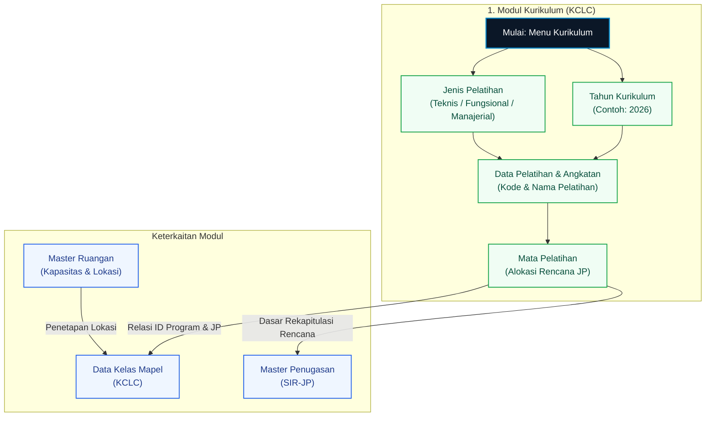
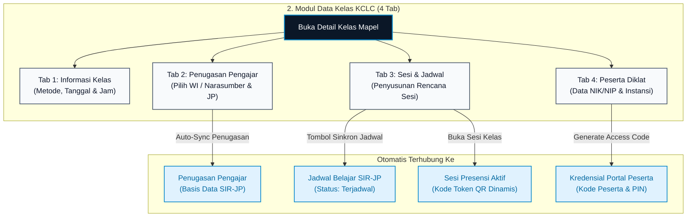
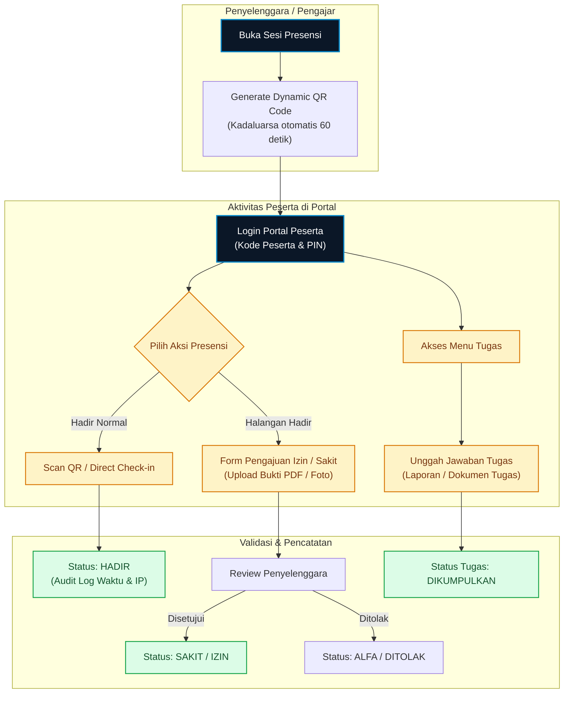
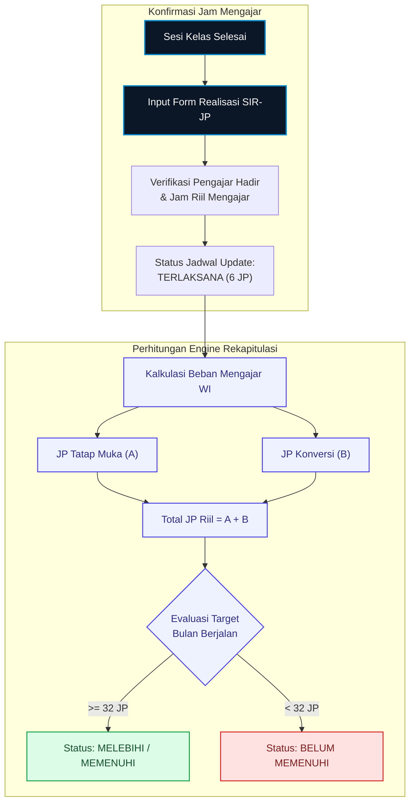
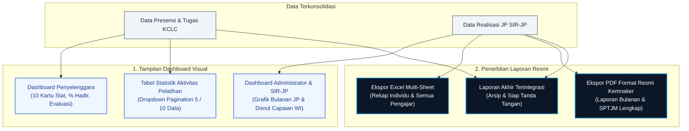

# DIAGRAM ALUR SISTEM KCLC & SIR-JP (KEMNAKER CORPU)

Dokumentasi diagram alur lengkap terpadu yang dipisah menjadi 5 modul utama menggunakan sintaks Mermaid.

---

## 1. Modul Kurikulum & Master Data (Tahap Awal)

---

## 2. Modul Data Kelas (KCLC) & Sinkronisasi SIR-JP

---

## 3. Modul Presensi & Portal Peserta (Hybrid Attendance)

---

## 4. Modul Realisasi Mengajar & Rekapitulasi JP (SIR-JP)

---

## 5. Modul Dashboard & Ekspor Laporan Akhir (Tahap Akhir)

